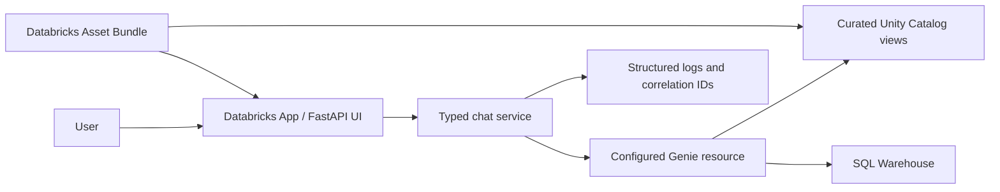

# Databricks LocalDevOps POC

A Databricks-native, read-only chatbot for authorized questions about curated Unity Catalog data. This project is isolated from the parent Flutter samples repository.

## Architecture



The application does not execute model-generated SQL. Unity Catalog permissions and a read-only Genie configuration are the authorization boundary. See [architecture](docs/architecture.md), [security](docs/security.md), and [decisions](docs/decisions.md).

## Repository structure

- `app/`: settings, typed models, application services, Databricks adapters, telemetry, FastAPI API, and static UI.
- `resources/sql/`: catalog, schema, synthetic demo data, curated views, and grants.
- `resources/genie/`: Genie configuration guidance and verified example questions.
- `tests/`: unit, contract, integration, and evaluation suites.
- `scripts/`: guarded bundle, seed, cleanup, and validation helpers.
- `docs/`: requirements, architecture, decisions, security, deployment, and local setup.

## Prerequisites and local setup

Install mise and activate it in a new terminal. `uv` is managed by mise for project reproducibility; this workstation also has uv installed through winget.

```powershell
mise install
uv sync --all-groups
Copy-Item .env.example .env
```

Use Databricks CLI OAuth/device authentication for live workspace operations. Do not put credentials in source control or commit `.env`. Client secrets are a documented fallback only when approved secretless authentication is unavailable.

## Run locally

```powershell
uv run poe run
```

Without a configured Genie resource, the app reports that the service is not configured; it does not invent demo answers. Set `DATABRICKS_GENIE_AGENT_ID` only after the target Genie resource and access policy are approved. Liveness and readiness are available at `/health/live` and `/health/ready`.

## Development and tests

```powershell
uv run poe format
uv run poe lint
uv run poe typecheck
uv run poe test-unit
uv run poe test-integration
uv run poe test-contract
uv run poe coverage
uv run poe security
uv run poe secret-scan
uv run poe evaluate
uv run poe validate
```

Unit tests do not require workspace access. Integration tests require explicit credentials, a Genie resource, warehouse, and UC permissions; missing prerequisites are reported as blocked/skipped, not passed. `poe validate` runs formatting checks, lint, type checking, unit tests, Bandit, secret scanning, and bundle validation when workspace configuration is available.

## Databricks Bundle and deployment

Set target-specific variables through Databricks bundle overrides, environment configuration, or an approved local untracked config. Never put workspace-specific IDs in tracked files.

```powershell
uv run poe bundle-validate
uv run poe seed-data
uv run poe deploy-dev
uv run poe deploy-test
uv run poe deploy-prod
```

Development/test/prod require configured hosts, identities, app names, Genie resource IDs, warehouse IDs, grants, and protected environment approval as applicable. Cleanup is separate from deployment, destructive, and always requires explicit confirmation. The runbook and rollback steps are in [deployment](docs/deployment.md).

Seed synthetic data with `uv run poe seed-data`. Grant access only after review with `uv run poe catalog-grant-reader -- --principal <UC-user-or-group>`. `uv run poe clean` removes local test/build caches only. Catalog deletion is a separate, destructive command requiring the exact configured demo catalog: `uv run python scripts/deploy_catalog.py clean --confirm-catalog <exact-demo-catalog>`.

## Sample questions

- What was total sales by month?
- Which products had the highest revenue last quarter?
- How many orders did each customer place?
- What is the average order value by product category?
- How does this compare with the previous month?

Answers must cite their Unity Catalog sources and identify ambiguous, inaccessible, unavailable, or empty-data cases.

## Configuration

See [local development](docs/local-development.md) for the environment-variable reference. Workspace host, OAuth client configuration, SQL Warehouse ID, Genie resource ID, app name, and production catalog are pending inputs; no real identifiers are supplied in this project.

## Troubleshooting

- `uv` is not found: open a new terminal after mise/winget updates PATH.
- Bundle validation lacks a target: authenticate using Databricks CLI OAuth and provide the target workspace configuration.
- Genie is not configured: local UI remains safe but cannot answer data questions until a real authorized resource is selected.
- Access denied: ask the Unity Catalog owner to review user-specific grants; do not work around the denial with a shared privileged identity.

## Assumptions and limitations

- Demo data is synthetic and uses the configurable `chatbot_demo` catalog default.
- Python 3.11 is the initial target; verify compatibility against the selected Databricks App runtime.
- App/Genie capability, per-user identity propagation, serverless SQL, and MLflow tracing must be confirmed in the target workspace.
- The current Databricks SDK adapter uses a Genie `space_id`; confirm the target resource is the supported Genie Agent/space API before deployment.
- Conversation content is ephemeral by default. Logging, feedback, and trace retention policies are pending organizational decisions.

## Specifications

- [Requirements](docs/requirements.md)
- [Architecture](docs/architecture.md)
- [Architecture decisions](docs/decisions.md)
- [Security](docs/security.md)
- [Deployment and rollback](docs/deployment.md)
- [Local development](docs/local-development.md)
- [Implementation plan](docs/implementation-plan.md)
