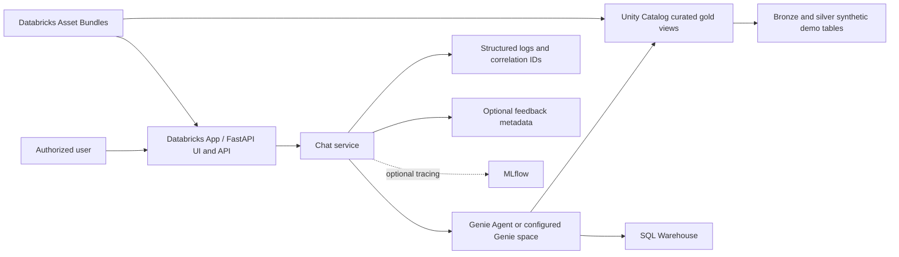
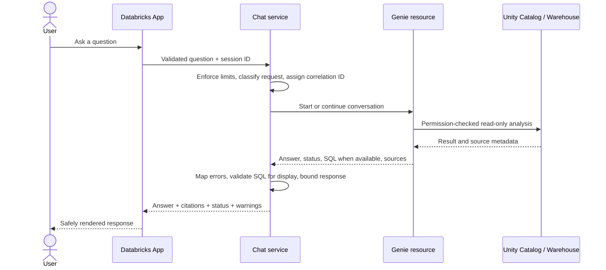
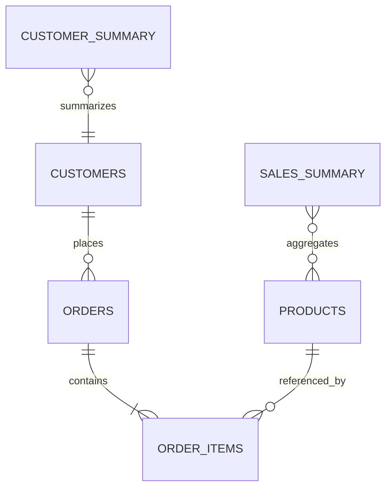

# Architecture

## Overview

The project uses one Databricks App process running FastAPI. It serves the chat UI and typed chat, feedback, health, and readiness endpoints from the same origin. The API calls an application service through typed models. The service uses a narrow Genie client interface, forwards the authenticated caller's question to the configured Genie resource, maps the response, and formats source citations. It never runs generated SQL. Genie is configured against curated Unity Catalog gold views and uses the SQL Warehouse permitted by the workspace. Unity Catalog remains the authorization boundary. The current SDK adapter calls the Genie `space_id` API; confirm that this is the target workspace's approved Genie Agent capability before deployment.

## Request sequence

## Data model

All demonstration records are synthetic. Bronze stores minimally transformed source-shaped data with ingestion metadata. Silver normalizes types, removes duplicate source keys, handles invalid/null data, and documents quality checks. Gold exposes curated business views for Genie. App and monitoring schemas hold only minimal feedback/audit metadata; prompt and answer text are not persisted by default.

## Boundaries and authorization

- UI: presentation and ephemeral session controls only; no SQL construction or data access. DOM insertion uses text nodes, not HTML interpretation.
- API: same-origin chat, feedback, health, and readiness routes; Databricks App access policy protects the application.
- Service: input policy, orchestration, response mapping, error classification, citations.
- Genie adapter: platform API calls and conversation IDs; credentials come from the Databricks App identity/runtime.
- Catalog bootstrap: SQL scripts run by an explicitly authorized deployment principal, never by the chat request path.
- Caller authorization: per-user authorization/passthrough must be verified for the selected App/Genie integration. A shared application identity with broader access is not an approved default.

## Capability gates

Workspace-specific availability has not been checked. If Databricks Apps, Genie integration/resource binding, serverless SQL, or MLflow tracing is unavailable, deployment is blocked pending a documented decision. The recommended alternative must be approved and documented before implementation behavior is switched; no external database, vector store, Azure Functions, or Kubernetes is introduced by default.